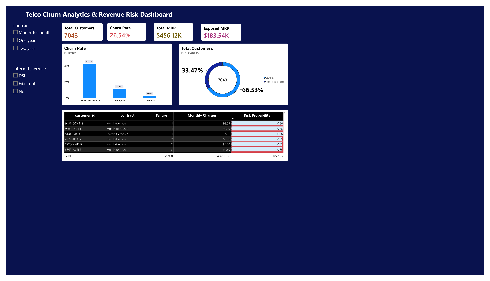
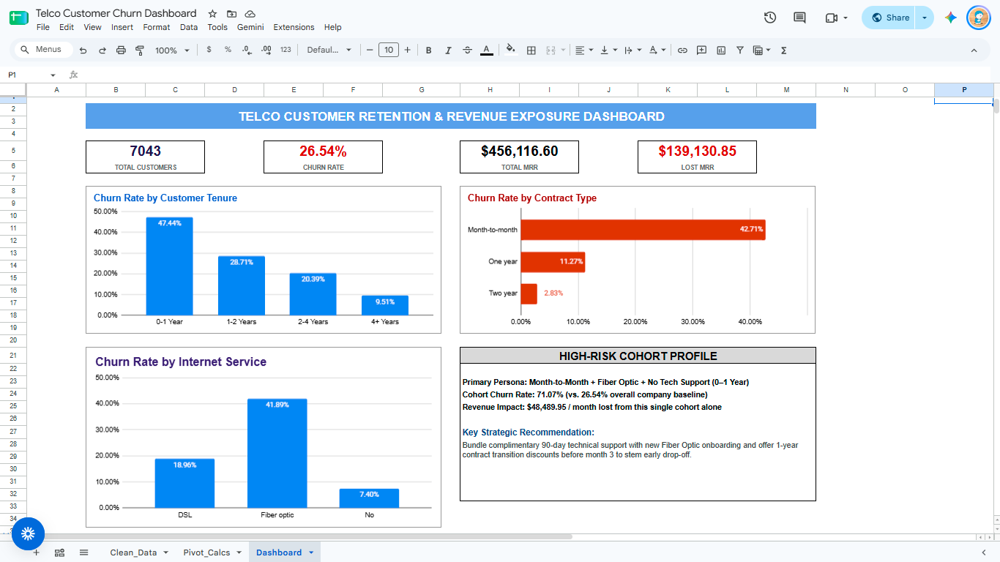
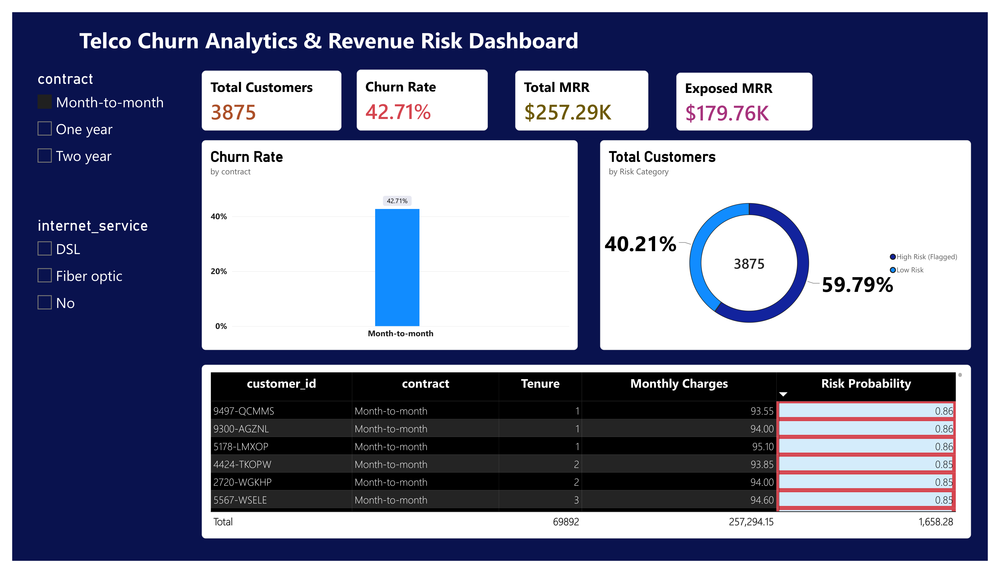

# Telco Churn & Revenue Risk


Connect executive revenue-risk reporting with reproducible machine-learning churn scoring to identify accounts for retention review.

## Impact at a Glance

- **$183.54K flagged monthly revenue exposure** across 2,357 accounts at the 0.35 cutoff; exposure is not realized or guaranteed loss.
- **$456.12K total MRR** in the historical snapshot.
- **7,043 customers**, including 1,869 historical churners (26.54%).
- **42.71% Month-to-month churn**, versus 11.27% for one-year and 2.83% for two-year contracts.
- **70.59% test recall at the 0.35 cutoff**: 264 of 374 test churners identified, with 222 false positives.
- **0.842 ROC-AUC** and **0.6337 Average Precision** on the stratified 20% test fold.

Revenue figures describe the full retrospective snapshot, including training rows and historical churners; model performance describes the held-out test fold. The 0.35 cutoff was a preset comparison, not a separately optimized or cost-validated threshold.

## What This Project Does

- **Find churn patterns:** compare contracts, internet services, and tenure using SQL analytics.
- **Rank account risk:** train a reproducible baseline and score customers by churn probability.
- **Translate risk into revenue exposure:** flag monthly charges for a proposed retention review queue.
- **Make findings usable:** provide executive Power BI exports, documented DAX measures, and a containerized prediction API.

## Dashboard Preview

[](docs/dashboard_overall.pdf)

[Overall dashboard PDF](docs/dashboard_overall.pdf) · [Month-to-month cohort PDF](docs/dashboard_month_to_month.pdf) · [Live Google Sheets dashboard](https://docs.google.com/spreadsheets/d/1txWOi8K12LKhqEunyHWKLgKyrPt0hz5dq3MdSzjqRlI/edit?usp=sharing)

The Power BI previews are static exports. The Month-to-month PDF shows a contract slice containing both risk classes. Desktop cross-filtering was tested and verified by the project author.

## Architecture

```text
Raw CSV -> PostgreSQL -> Cleaned CSV -> Python ML pipeline
           staging,                      |
           cleaning, SQL                 +-> Scored CSV + cleaned data
                                         |        |
                                         |        v
                                         |   Power BI / DAX -> Executive risk views
                                         |
                                         +-> Saved pipeline (.joblib)
                                                  |
                                                  v
                                             FastAPI -> Docker service
```

Python currently reads the local cleaned CSV; it does not query PostgreSQL directly. Power BI consumes a documented one-row-per-customer merge of cleaned and scored exports. The saved preprocessor/model is reused by batch scoring and the API without refitting; Google Sheets remains a separate reporting artifact.

**Artifact status:** SQL, Python scoring, the API, Docker configuration, the Google Sheets dashboard, and exported Power BI dashboard PDFs/PNG previews are available. The exports show the completed baseline and Month-to-month views. Desktop cross-filtering was tested and verified by the project author. The complete Power BI model is bundled at [pbix/Telco_Revenue_Risk_Dashboard.pbix](pbix/Telco_Revenue_Risk_Dashboard.pbix). The semantic model has not been independently inspected here.

## Problem Statement & Business Context

Telecommunications businesses depend on recurring subscription revenue. Customer churn affects account volumes and revenue differently: higher monthly charges can concentrate exposure in a relatively small group. This project asks who churns, which segments correlate with churn, and which accounts should enter a retention review queue.

Historical churn, model flags, and revenue exposure are distinct concepts. A risk flag is not an observed departure, and flagged MRR is not a guaranteed loss or retention opportunity. Outreach recommendations require a current eligible-customer population and validation of intervention costs and effectiveness.

## Executive Metrics & Findings

| Metric | Snapshot result | Interpretation |
| :--- | ---: | :--- |
| Customer base | 7,043 | Unique subscriber records |
| Observed churn rate | 26.54% | 1,869 historical churners |
| Total MRR | $456.12K | $456,116.60 in snapshot monthly charges |
| High-risk exposed MRR | $183.54K | $183,535.15 flagged at probability >=0.35 |
| High-risk accounts | 2,357 | Full-snapshot model flags, not new holdout predictions |
| Month-to-month churn | 42.71% | Compared with 11.27% for one-year and 2.83% for two-year contracts |
| Churn-associated MRR share | 30.50% | $139,130.85 associated with historical churners |

Multiplying churn-associated monthly charges by 12 gives $1,669,570.20 (approximately $1.67M). This is an annualized extrapolation, not measured annual loss. The full-snapshot risk export includes training rows and historical churners.

**Proposed action queue:** filter to high-risk, currently eligible retained customers (`churn = "No"` in this historical dataset), then prioritize tenure **<3 months** and monthly charges **$80–$95 inclusive**. Sort by churn probability descending, then monthly charges descending. This is a proposed business targeting rule, not a statistically optimized or proven highest-impact segment. Do not contact historical churners as if they were active subscribers.

## Dashboard Details & Interactive Walkthrough

[](https://docs.google.com/spreadsheets/d/1txWOi8K12LKhqEunyHWKLgKyrPt0hz5dq3MdSzjqRlI/edit?usp=sharing)

[Open the live Google Sheets dashboard](https://docs.google.com/spreadsheets/d/1txWOi8K12LKhqEunyHWKLgKyrPt0hz5dq3MdSzjqRlI/edit?usp=sharing). The preview above is the existing spreadsheet dashboard, not a Power BI screenshot.

Build/verify these Power BI interactions using [the report setup guide](docs/power_bi_setup.md):

1. **Baseline view:** clear all slicers and check the executive KPI cards against the table above.
2. **Dynamic cross-filtering:** select contract and internet-service slicers together. Confirm cards, charts, and the action table respond to both selections. Month-to-month churn should be 42.71% with only that contract filter applied.
3. **Probability sorting:** sort the action table by `churn_probability` descending; retain customer ID for auditing, but mask it in public screenshots.
4. **In-cell conditional formatting:** use probability data bars or a color scale and currency formatting for exposure. High risk begins at 0.35; color conveys model flags, not realized outcomes.
5. **Sliced high-risk view:** combine Month-to-month with the high-risk flag; optionally add the proposed tenure/charge targeting filters. Label all active filters and avoid comparing a sliced total with the full baseline as if they were the same cohort.

### Completed Power BI exports

**Overall baseline** — 7,043 customers, 26.54% churn, $456.12K MRR, $183.54K exposure.

[Open overall PDF](docs/dashboard_overall.pdf) or use the preview at the top of this page.

**Month-to-month cohort** — 3,875 customers, 42.71% churn, $257.29K MRR, $179.76K exposure. The shown filter is contract only; the cohort contains both risk classes.

[](docs/dashboard_month_to_month.pdf)

[Open Month-to-month PDF](docs/dashboard_month_to_month.pdf). Both PNGs render the first page at 200 DPI (4,100 x 2,350 pixels), preserving the supplied layout. Static exports demonstrate the displayed views, not live cross-filtering. See [artifact index](docs/README.md) and [image notes](images/README.md).

## Core DAX Measures

The documented semantic model is a single merged table named **`Customers`**, with exactly one row per customer. Left-join cleaned data to the scoring export by `customer_id`, expanding only the three scoring columns; see the setup guide. The scoring CSV alone does not contain observed `churn` or internet-service fields.

Create each measure separately in Power BI using [dax/measures.dax](dax/measures.dax):

```dax
Total Customers = DISTINCTCOUNT('Customers'[customer_id])

Churned Customers =
    CALCULATE(
        [Total Customers],
        KEEPFILTERS('Customers'[churn] = "Yes")
    )

Churn Rate = DIVIDE([Churned Customers], [Total Customers], 0)

Total MRR = SUM('Customers'[monthly_charges])

Exposed MRR = SUM('Customers'[monthly_revenue_at_risk])
```

Format `Churn Rate` as a percentage (two decimals), counts as integers, and MRR as currency. These measures respect the current slicer context; exposure uses the exported 0.35 flag and is not recomputed by a probability slicer. DAX definitions are authored for the documented schema and have not been executed in Power BI here. Reference: [Microsoft CALCULATE documentation](https://learn.microsoft.com/dax/calculate-function-dax).

## View or Build the Power BI Report

Open the bundled [Telco Revenue Risk Dashboard](pbix/Telco_Revenue_Risk_Dashboard.pbix) in Power BI Desktop. See [report notes](pbix/README.md) for refresh guidance.

Update local CSV source paths in Power Query and refresh before comparing totals. To build from scratch, follow [docs/power_bi_setup.md](docs/power_bi_setup.md), import the DAX measures, configure the visuals/interactions, and save the report under `pbix/`. No local Excel dashboard is required.

## Repository Structure

The display name is **telco-churn-revenue-risk**; the existing GitHub repository and local folder have not been renamed.

```text
telco-customer-churn-analysis/
├── README.md
├── .gitignore
├── assets/README.md            # points to canonical images/ exports
├── images/
│   ├── README.md
│   ├── dashboard_overview.png
│   └── dashboard_sliced_risk.png
├── docs/
│   ├── README.md
│   ├── power_bi_setup.md
│   ├── dashboard_overall.pdf
│   └── dashboard_month_to_month.pdf
├── pbix/
│   ├── README.md
│   └── Telco_Revenue_Risk_Dashboard.pbix
├── dax/
│   └── measures.dax
├── dashboards/
│   └── dashboard_preview.png   # existing Google Sheets preview
├── data/
│   ├── raw/                   # optional ignored source data
│   ├── processed/
│   │   └── cleaned_telco_churn.csv
│   └── predictions/
│       └── customer_churn_scored.csv  # generated, ignored
├── models/
│   └── baseline_logistic_pipeline.joblib  # generated, ignored
├── python/                    # train_baseline.py, predict.py, requirements.txt
├── app/                       # main.py, schemas.py, requirements.txt, test_api.py
├── sql/                       # 01_schema.sql through 05_views_and_procedures.sql
├── Dockerfile
└── docker-compose.yml
```

The scored CSV stays in `data/predictions/` to preserve the working pipeline and its privacy exclusions; do not duplicate it under tracked `data/processed/`.

## Run and Test the Data Pipeline

Use Python 3.12 or newer. From the repository root, with the cleaned CSV available:

```powershell
python -m venv .venv
.\.venv\Scripts\python.exe -m pip install -r app/requirements.txt
.\.venv\Scripts\python.exe python/train_baseline.py
.\.venv\Scripts\python.exe python/predict.py
.\.venv\Scripts\python.exe -m unittest app.test_api -v
```

Training validates the schema/IDs, fits only on training rows, prints test metrics and coefficients, and verifies saved-model reload predictions. Scoring writes the ignored audit CSV. Confirm 7,043 unique scored accounts, 2,357 high-risk flags, and $183,535.15 exposure before refreshing the report. No PostgreSQL execution is needed for this CSV workflow. SQL scripts are available for database reconstruction, but contain table drops and a machine-specific import path; inspect them before executing.

## Python Baseline ML Pipeline

`python/train_baseline.py` fits a **Logistic Regression** pipeline with **StandardScaler** for tenure, monthly charges, and total charges, plus **OneHotEncoder(handle_unknown="ignore")** for categorical features. Customer ID and the redundant tenure cohort are excluded from features. Schema, unique IDs, and churn labels are validated before modeling.

Validation uses a **stratified 80/20 train/test split (random_state=42)**: 5,634 training accounts and 1,409 test accounts, including 374 test churners. Preprocessing and the classifier are fitted strictly on training rows. The dummy classifier and retrospective SQL heuristic are evaluated on the exact same test fold.

| Model / cutoff | ROC-AUC | Average Precision (PR-AUC summary) | Precision | Recall |
| :--- | ---: | ---: | ---: | ---: |
| Dummy (most frequent) | 0.5000 | 0.2654 | 0.0000 | 0.0000 |
| SQL heuristic (score >=70) | 0.8238 | 0.5722 | 0.5479 | 0.6578 |
| Logistic Regression (0.50) | 0.8420 | 0.6337 | 0.6572 | 0.5588 |
| Logistic Regression (0.40) | 0.8420 | 0.6337 | 0.5682 | 0.6684 |
| Logistic Regression (0.35) | 0.8420 | 0.6337 | 0.5432 | 0.7059 |

**Chosen business cutoff: 0.35**, prioritizing churn capture. It captures **70.59% recall (264 / 374 test churners)**, with 222 false positives. This was a preset threshold comparison; it has not been optimized on a separate validation set or validated against retention costs. Test results describe the observed tradeoff, not proof of an optimal cutoff.

### Coefficients and persistence

The script matches coefficients to the fitted transformed feature names and prints the top five positive and negative weights. Examples include **Fiber optic (+0.65)**, **Month-to-month (+0.59)**, and **Tenure (-1.26)**. These are conditional model weights on the log-odds scale, not causal effects. Numeric coefficients represent one training-set standard deviation; categorical coefficients represent indicators.

**Multicollinearity:** Total Charges, Monthly Charges, and Tenure are related because accumulated charges depend on billing amount and customer duration. Their coefficients can redistribute shared information and have counterintuitive signs. Full one-hot encoding and correlated service features further limit direct comparisons; individual weights should not be interpreted as standalone business effects.

The complete training-fitted preprocessor and classifier are saved to `models/baseline_logistic_pipeline.joblib`. Reload verification confirms identical probabilities on all test rows. The binary is ignored by Git and must be regenerated locally; only load trusted model artifacts.

### Batch scoring and revenue exposure

`python/predict.py` loads the saved pipeline without refitting, scores **7,043 accounts**, and flags **2,357 accounts** at probability >=0.35. Their monthly charges total **$183,535.15 in monthly revenue exposure**. Average churn probability is **26.59%**.

The ignored audit export `data/predictions/customer_churn_scored.csv` contains `customer_id`, `tenure`, `contract`, `monthly_charges`, `churn_probability`, `predicted_churn_flag`, and `monthly_revenue_at_risk`. Revenue at risk equals monthly charges for flagged accounts and zero otherwise; it is not probability-weighted expected loss. Flag 0 means below the cutoff, not guaranteed safe.

This is retrospective scoring of the full snapshot, including training rows and historical churners. It is not a fresh holdout evaluation, a live retention list, or a forecast with a defined future horizon.

### Reproduce locally (Windows PowerShell)

Run from the repository root with `data/processed/cleaned_telco_churn.csv` available:

```powershell
python -m venv .venv
.\.venv\Scripts\python.exe -m pip install -r app/requirements.txt
.\.venv\Scripts\python.exe python/train_baseline.py
.\.venv\Scripts\python.exe python/predict.py
```

For the baseline and service, `app/requirements.txt` pins pandas, numpy, scikit-learn, joblib, FastAPI, and Uvicorn. Use Python 3.12 or newer for these pins. `python/requirements.txt` records the broader development dependency set.

---

## Production Microservice & Containerization

The FastAPI service packages the persisted baseline pipeline in a **Python 3.12 slim** container. Install Docker with Compose and run from the repository root. Before building, ensure the trusted local artifact `models/baseline_logistic_pipeline.joblib` exists: it is ignored by Git and is not included in a fresh clone. Generate it with `python/train_baseline.py` using the ML dependencies documented above.

Launch the service in one command:

```bash
docker compose up --build -d
```

Compose builds the image, publishes port 8000, applies `unless-stopped` restart behavior, and checks `/health`. The image copies the API and model artifact; it does not bundle the customer CSV. Dependency installation uses `app/requirements.txt` as a cached build layer.

| Endpoint | Purpose |
| :--- | :--- |
| `GET /health` | Service/model readiness check; returns `{"status": "healthy"}` after model initialization. |
| `GET /analytics/summary` | Static cohort churn/retention context and MRR benchmarks: 7,043 customers, 26.54% churn, and $183,535.15 flagged monthly exposure at 0.35. These are retrospective snapshot figures, not live cohort calculations. |
| `POST /predict-risk` | Request-time churn probability, risk tier, high-risk flag, and monthly exposure for one validated account. |

Swagger interactive documentation is available at [http://localhost:8000/docs](http://localhost:8000/docs). Select `POST /predict-risk`, click **Try it out**, and submit this synthetic JSON example (no customer ID or observed churn label is required):

```json
{
  "gender": "Female",
  "senior_citizen": 1,
  "partner": "No",
  "dependents": "No",
  "tenure": 6,
  "phone_service": "Yes",
  "multiple_lines": "No",
  "internet_service": "Fiber optic",
  "online_security": "No",
  "online_backup": "No",
  "device_protection": "No",
  "tech_support": "No",
  "streaming_tv": "Yes",
  "streaming_movies": "Yes",
  "contract": "Month-to-month",
  "paperless_billing": "Yes",
  "payment_method": "Electronic check",
  "monthly_charges": 85.0,
  "total_charges": 510.0
}
```

The response contains `churn_probability`, `risk_tier`, `is_high_risk`, and `revenue_at_risk`. High risk is probability >=0.35; Moderate is >=0.20 and <0.35; Low is <0.20. The Moderate boundary is a display policy, not a separately validated threshold. Exposure equals monthly charges for high-risk accounts and zero otherwise, not probability-weighted expected loss. Invalid input receives HTTP 422; missing or incompatible model artifacts prevent startup.

Inspect status and stop the service with:

```bash
docker compose ps
docker compose down
```

The service currently has no authentication or TLS configuration; use it locally or behind an appropriately secured deployment boundary. Model probabilities and the chosen cutoff retain the retrospective limitations described above.

---
